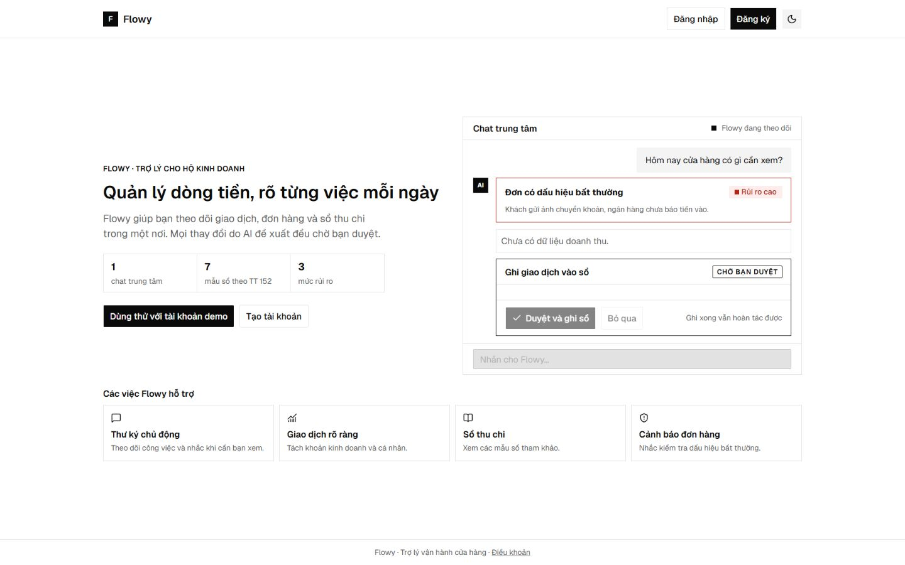

# Flowy



Flowy là trợ lý vận hành dòng tiền dành cho hộ kinh doanh, kết hợp giao diện quản lý và các luồng hỗ trợ bằng AI.

## Vấn đề và giải pháp

Hộ kinh doanh trực tuyến thường theo dõi đơn hàng, giao dịch và thu chi trên nhiều kênh. Việc đối chiếu thủ công mất thời gian và có thể bỏ sót thông tin khi xử lý đơn hoặc ghi sổ.

Flowy hướng tới việc tập trung các thông tin này trong một giao diện, hỗ trợ nhận diện tình huống cần kiểm tra và trình bày công việc để chủ hộ xem xét. Các thay đổi do AI đề xuất được thiết kế để người dùng duyệt trước khi thực hiện và có thể hoàn tác.

**Trạng thái dự án:** sản phẩm đang phát triển. Nhiều màn hình nghiệp vụ hiện dùng dữ liệu giả lập; kết nối dữ liệu máy chủ, trợ lý AI đầu cuối, đối soát SePay và xử lý Messenger thực tế chưa hoàn tất. Không sử dụng các số liệu giả lập làm căn cứ vận hành hoặc kê khai.

## Tính năng chính

| Tính năng | Trạng thái |
|---|---|
| **Chat trung tâm và luồng việc** | Có giao diện chat, luồng việc, thẻ thông báo và bước chờ duyệt. Nội dung và hành vi trợ lý trên giao diện hiện được giả lập; kết nối AI đầu cuối đang phát triển. |
| **Quản lý thu chi và giao dịch** | Có màn hình giao dịch, gán đơn, nhập khoản thu chi và báo cáo. Các màn hình nghiệp vụ hiện dùng mock; kết nối dữ liệu máy chủ và đối soát thực tế đang phát triển. |
| **Mẫu sổ theo Thông tư 152/2025/TT-BTC** | Có danh sách mẫu, xem trước và xuất PDF/Excel. Các mẫu cần được đối chiếu bản gốc trước khi sử dụng; dữ liệu sổ thực tế và việc xác định nghĩa vụ thuế đang phát triển. |
| **Cảnh báo rủi ro** | Có giao diện ba mức Thấp, Trung bình, Cao và màn hình xử lý cảnh báo giả lập. Phát hiện rủi ro từ dữ liệu thực tế đang phát triển. |
| **Bot Messenger** | Có giao diện hội thoại và điều khiển trạng thái AI với dữ liệu giả lập. Xử lý tin nhắn và kết nối Messenger đầu cuối đang phát triển. |

Ứng dụng cũng có trang giới thiệu, đăng ký, đăng nhập và quản lý phiên. Tệp dữ liệu cục bộ tùy chọn và thông tin xác thực không được đưa vào kho mã.

## Kiến trúc và công nghệ

```text
Trình duyệt
    │
    ▼
React + Vite + shadcn/ui ── HTTP ──► Express 5 ──► PostgreSQL
        │                                │
        └── Mock nghiệp vụ               ├── Lớp AI / nhà cung cấp mô hình
                                         ├── Meta Messenger (đang phát triển)
                                         └── SePay (đang phát triển)
```

| Thành phần | Công nghệ và phạm vi |
|---|---|
| Giao diện | React, TypeScript, Vite, Tailwind CSS và shadcn/ui; hệ thống thiết kế Flowy trong `client/`. |
| Máy chủ | Node.js và Express 5; xác thực, kiểm tra trạng thái, các tuyến webhook và lớp tích hợp AI. |
| Cơ sở dữ liệu | PostgreSQL; schema và migration nằm trong `server/src/db/`. |
| AI | Có lớp gọi nhà cung cấp tương thích OpenAI và chế độ giả lập; tích hợp vào luồng nghiệp vụ đang phát triển. |
| Thanh toán và nhắn tin | SePay và Meta Messenger là các tích hợp đang phát triển; webhook SePay chưa thực hiện đối soát. |

Tài liệu kỹ thuật bổ sung: [Kiến trúc](docs/ARCHITECTURE.md), [API](docs/API.md), [Cơ sở dữ liệu](docs/DATABASE.md) và [Hệ thống thiết kế](docs/design-system/README.md).

## Chạy bằng Docker Compose

Yêu cầu: Docker Engine và Docker Compose. Các lệnh dưới đây thực hiện tại thư mục gốc của dự án.

1. Tạo tệp cấu hình máy chủ từ mẫu và điều chỉnh các giá trị cần thiết trên máy cục bộ:

   ```bash
   cp server/.env.example server/.env
   ```

   Trên PowerShell, có thể dùng `Copy-Item server/.env.example server/.env`. Thiết lập `JWT_SECRET` phù hợp trước khi sử dụng; các khóa tích hợp chỉ được cấu hình khi cần.

2. Khởi động ứng dụng:

   ```bash
   docker compose up -d --build
   ```

3. Truy cập giao diện tại [http://localhost:5173](http://localhost:5173). Máy chủ lắng nghe tại `http://localhost:4000`; PostgreSQL sử dụng cổng `5432` theo mặc định. Compose tự chạy migration máy chủ khi khởi động.

Một số lệnh phục vụ phát triển:

```bash
docker compose ps
docker compose logs -f server
docker compose exec client npm run build
docker compose exec client npm run lint
docker compose exec server npm test
docker compose down
```

## Cấu trúc thư mục

```text
.
├── client/                 Giao diện React, component và các lớp API
├── server/                 Express API, dịch vụ, xác thực và migration
│   └── src/
│       ├── controllers/    Xử lý yêu cầu và phản hồi
│       ├── db/             Kết nối và migration PostgreSQL
│       ├── middlewares/    Xác thực, kiểm tra dữ liệu và xử lý lỗi
│       ├── routes/         Định tuyến API và webhook
│       └── services/       Nghiệp vụ và lớp tích hợp AI
├── docs/                   Tài liệu kỹ thuật và hệ thống thiết kế
├── docker-compose.yml      Môi trường phát triển bằng Docker
└── Dockerfile              Cấu hình ảnh ứng dụng
```

## Biến môi trường

Danh sách và hướng dẫn cấu hình nằm trong [server/.env.example](server/.env.example), [client/.env.example](client/.env.example) và [.env.example](.env.example) ở thư mục gốc. Các nhóm cấu hình gồm cơ sở dữ liệu, JWT, AI, SePay và Messenger.

Không đưa tệp `.env`, khóa, mật khẩu hoặc token vào kho mã. Biến có tiền tố `VITE_` được đưa vào mã phía trình duyệt và không được chứa thông tin bí mật.

## Nhóm FearOfUnemployment

| Thành viên | Vai trò |
|---|---|
| Duy | Giao diện sản phẩm, xác thực và tích hợp ứng dụng. |
| Thịnh | Máy chủ, cơ sở dữ liệu, webhook và đối soát thanh toán. |
| Viên | Lớp AI và tích hợp mô hình. |
