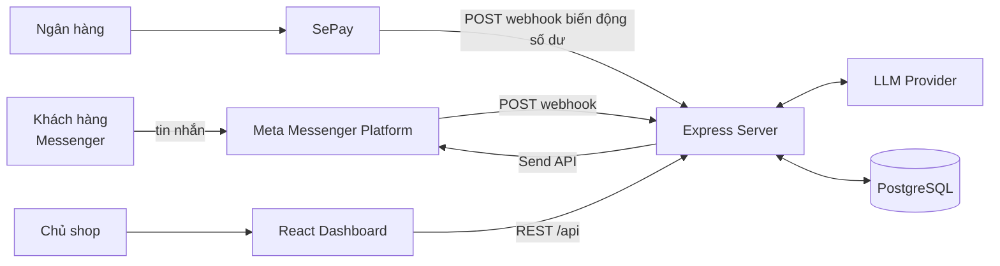
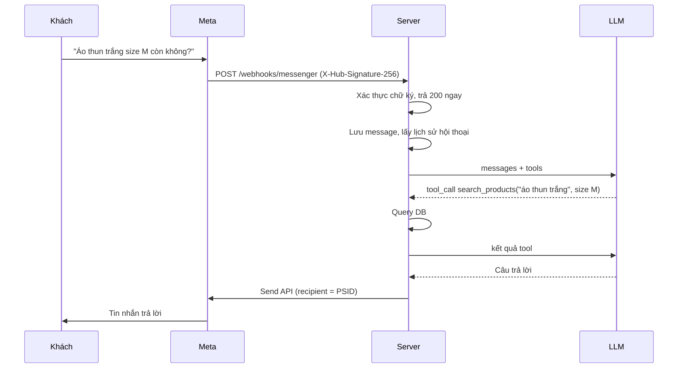
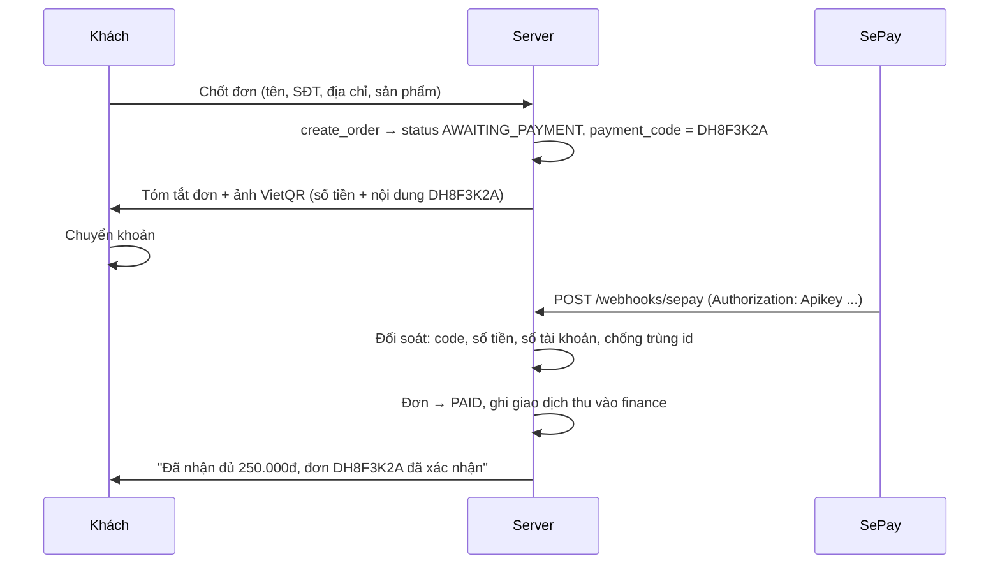
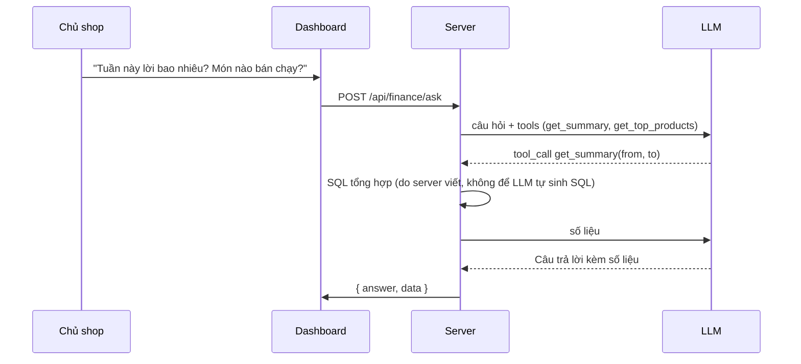

# Kiến trúc

## Tổng quan



## Phân lớp backend

```
request → routes/ → middlewares/ → controllers/ → services/ → db/
                                        ↓ lỗi (throw HttpError)
                                   errorHandler → { error: { code, message } }
```

| Lớp | Được làm | Không được làm |
|---|---|---|
| `routes/` | Khai báo method + path, gắn middleware (verify chữ ký/API key, body parser, `validate(schema)`), trỏ tới controller | Viết handler inline, gọi service/db |
| `controllers/` | Đọc `req.body` / `req.params` / `req.validatedQuery`, gọi service, chọn status code, trả JSON | Business logic, tính tiền, mở transaction, truy cập `db/` |
| `services/` | Business logic, transaction (đổi trạng thái đơn + ghi sổ + trừ kho), gọi API ngoài, gọi `db/` | Đọc `req` / ghi `res` |
| `db/` | Pool kết nối, migration | |

Quy ước tên: `routes/orders.js` → `controllers/orders.controller.js` → `services/order.service.js`.
Controller là hàm async; lỗi được Express 5 tự chuyển tới `errorHandler`, nên không bọc try/catch.

Ví dụ:

```js
// routes/orders.js
ordersRouter.post('/', validate(createOrderBody), ordersController.create)

// controllers/orders.controller.js
export const create = async (req, res) => {
  res.status(201).json(await orderService.create(req.body))
}
```

## Module backend

| Module | Trách nhiệm |
|---|---|
| `messenger.service` | Parse webhook event, gửi tin nhắn (text, ảnh QR, quick replies) qua Send API |
| `ai.service` | Gọi LLM, giữ lịch sử hội thoại, thực thi các tool (`search_products`, `create_order`…) |
| `order.service` | Tạo/cập nhật đơn, sinh mã thanh toán duy nhất, quản lý vòng đời trạng thái |
| `payment.service` | Nhận webhook SePay, đối soát giao dịch với đơn, chống trùng, đánh dấu PAID |
| `finance.service` | Ghi sổ thu chi, tổng hợp báo cáo, trả lời câu hỏi tài chính của chủ shop |

## Luồng 1 — Khách nhắn tin → AI trả lời



Lưu ý: trả `200` cho Meta trước, xử lý AI **bất đồng bộ** (tránh timeout/retry gây trả lời trùng). Chống trùng bằng `message.mid`.

## Luồng 2 — Tạo đơn + thanh toán + chống scam



Nếu khách gửi ảnh chụp màn hình "đã chuyển khoản" mà chưa có webhook → AI trả lời là hệ thống đang chờ ngân hàng xác nhận, **không** xác nhận đơn. Chi tiết: [PAYMENT_ANTI_SCAM.md](PAYMENT_ANTI_SCAM.md).

## Luồng 3 — Trợ lý tài chính



## Tài liệu tham khảo

- Meta Messenger Webhooks: https://developers.facebook.com/docs/messenger-platform/webhooks
- SePay Webhooks: https://developer.sepay.vn/en/sepay-webhooks/tich-hop-webhook
