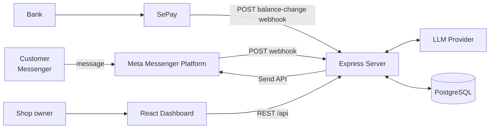
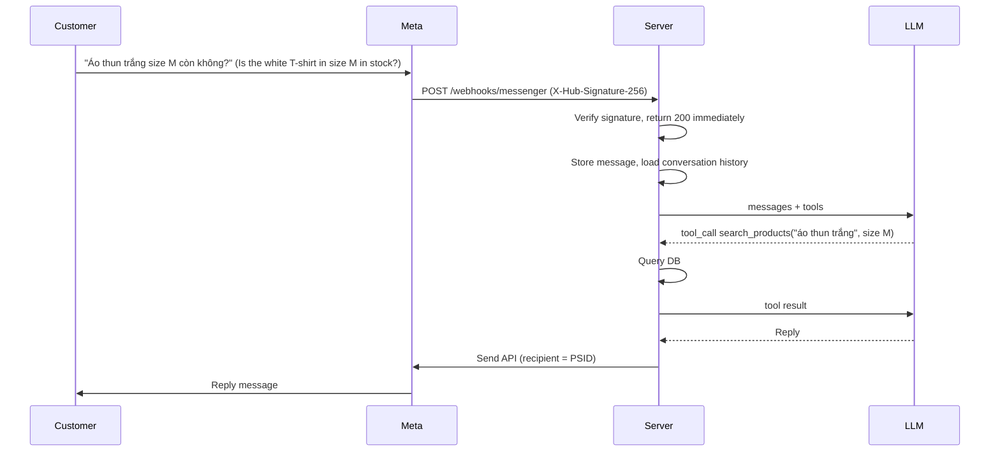
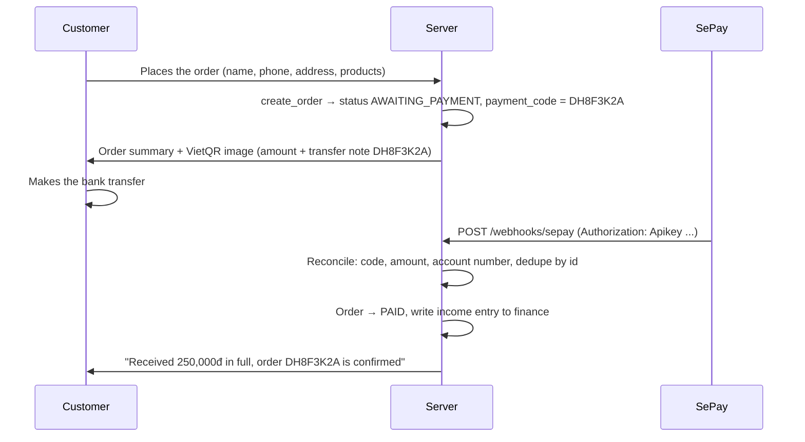
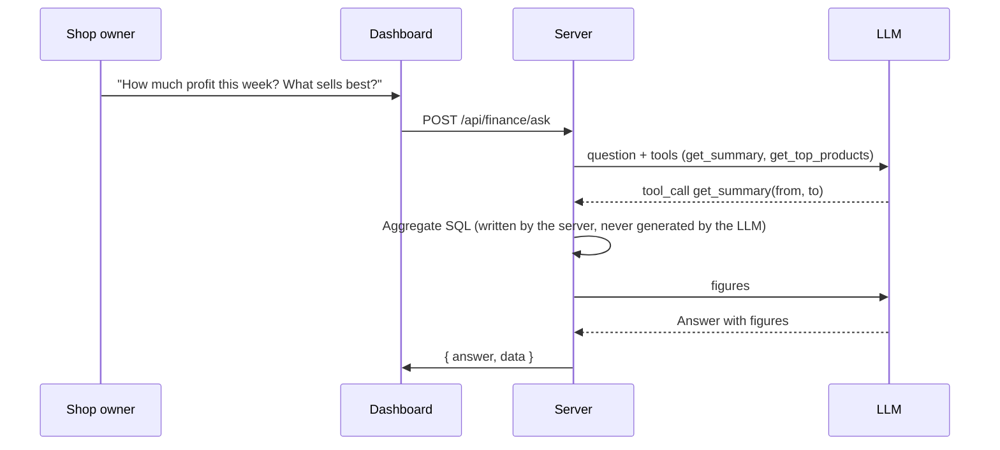

# Architecture

## Overview



## Backend layering

```
client → app.js → routes/ → middlewares/ → validators/ → controllers/ → services/ → repositories/ → db/ (pool)
                                                    ↓ error (throw appError('CODE'), or any error)
                                               errorHandler → toAppError() → { error: { code, message } }
```

| Layer | Does | Does not |
|---|---|---|
| `app.js` | The only entry point. `createApp()` registers every global middleware and every router; `startServer()` (run by `node src/app.js`) recovers the assistant, starts listening, starts background jobs and handles shutdown | Feature logic |
| `routes/` | Declares method + path and the chain: shared middleware (signature/API key check, body parser, auth, rate limit), then the route's validator, then the controller | Write inline handlers or zod schemas, call services/repositories |
| `validators/` | The zod schema of each route's input (`body`, `params`, `query`) and the middleware that applies it (see "Validators") | Business rules that need the database |
| `controllers/` | Reads `req.body` / `req.params` / `req.validatedQuery`, calls a service, picks the status code, returns JSON | Business logic, money calculations, opening transactions, accessing `repositories/` or `db/` |
| `services/` | Business logic, transactions (order status change + ledger entry + stock decrement), external API calls, calls `repositories/` (transactions through `withTransaction` from `repositories/database.js`) | Read `req` / write `res`, import from `db/`, run a query (it goes in a repository) |
| `repositories/` | Every query, **one file per table** (see "Repositories"); `shopId` first, optional transaction client last. Reaches the database only through `config/database.js` | Business logic, opening transactions, importing `db/pool.js` or `db/dataSource.js` |
| `config/database.js` | The one door to the database for repositories (see "Database access"): `query()`, `withTransaction()`, `getRepository(Model)`, `transaction()` | Queries for a feature |
| `db/` | Infrastructure behind `config/database.js`: the TypeORM `DataSource` and its single connection pool, `pg` settings, migrations, seed | Queries for a feature |
| `models/` | The shape of each table: TypeORM entity schemas, one per table (see "Models (TypeORM)") | Queries, business logic |

Naming: `routes/orders/orders.js` → `validators/orders/orders.validator.js` → `controllers/orders/orders.controller.js` → `services/orders/order.service.js` → `repositories/orders/order.repository.js`, with the table shape in `models/orders/Order.js`.
Controllers are async functions; Express 5 forwards their errors to `errorHandler`, so no try/catch is needed.

Example:

```js
// routes/orders/orders.js
ordersRouter.post('/', ordersValidator.create, ordersController.create)

// validators/orders/orders.validator.js
export const create = validate(z.object({ ... }).strict(), 'body', 'Thông tin đơn không hợp lệ.')

// controllers/orders/orders.controller.js
export const create = async (req, res) => {
  res.status(201).json(await orderService.create(req.body))
}
```

### Feature folders

Every layer keeps its role, and inside each layer the files are grouped into **one folder per feature**, the same way `services/ai/` and `services/assistant/` already are. A feature uses the same folder name in every layer it appears in.

- Files keep their layer suffix (`.validator.js`, `.controller.js`, `.service.js`, `.repository.js`) so they stay easy to search for.
- Inside a folder, a prefix that only repeats the folder name is dropped: `routes/webhook.sepay.js` becomes `routes/webhook/sepay.js`.
- A new feature gets a new folder in each layer it needs; no new files directly under `routes/`, `validators/`, `controllers/`, `services/`, `repositories/` or `models/`.
- Only shared entry points stay at a layer root: `validators/validate.js` (the shared `validate()` helper), `models/index.js` (lists every entity) `repositories/guard.js` (the shared `requireShopId` check) and `repositories/database.js` (`withTransaction` and `ping` for services). Routers are registered in `app.js`, so `routes/` has only feature folders. `db/` has no feature folders: it holds only `pool.js`, `dataSource.js`, `migrate.js`, `seed.js` and `migrations/`.
- `middlewares/`, `errors/`, `lib/` and `config/` are shared across features and stay flat.

| Feature | `routes/` | `controllers/` | `services/` | `repositories/` and `models/` |
|---|---|---|---|---|
| `agent` | | | | `agentRun`, `agentRunEvent`, `change` |
| `ai` | | | `client.js`, `toolLoop.js`, `prompts/`… (model layer) | `aiUsage` |
| `alerts` | `alerts.js` | `alerts.controller.js` | `alerts.service.js` | `assistantAlert` |
| `assistant` | `assistant.js` | `assistant.controller.js` | `assistant.service.js`, `agent.js`, `tools/`… | `assistantThread`, `assistantMessage`, `assistantStep`, `assistantActionLog`, `assistantFile` |
| `auth` | `auth.js` | `auth.controller.js` | `auth.service.js` | `user` |
| `demo` | `demo.js` | `demo.controller.js` | `demo.service.js` | |
| `dev` | `dev.js` | `dev.controller.js` | | |
| `finance` | `finance.js` | `finance.controller.js` | `finance.service.js`, `ledger.service.js` | `ledgerEntry`, `label` |
| `guardrail` (planned, NV-00) | | | `guardrail.service.js` | |
| `health` | `health.js` | `health.controller.js` | `health.service.js` | |
| `messenger` | | | | `customer`, `conversation`, `message` |
| `orders` | `orders.js` | `orders.controller.js` | `order.service.js` | `order`, `orderItem` |
| `payments` | | | `payment.service.js`, `fraud.service.js` | `paymentTransaction`, `fraudCheck`, `blocklist` |
| `products` | | | | `product` |
| `shop` | | | `shop.service.js` | `shop`, `pin`, `todo` |
| `webhook` | `messenger.js`, `sepay.js`, `sim.js` | `messenger.controller.js`, `sepay.controller.js`, `sim.controller.js` | `webhook.service.js`, `sim.service.js` | `webhookEvent` |

Validators: `validators/<feature>/<feature>.validator.js` exists for `alerts`, `assistant`, `auth`, `dev`, `finance` and `orders`. The other routers take no client input that needs a schema (`demo`, `health`), or check a signature on the raw body first (`webhook`).

In the last column, `order` means `repositories/orders/order.repository.js` (all queries for `orders`) and `models/orders/Order.js` (the table shape).

## Errors (`errors/`)

`server/src/errors/` decides the HTTP status and the response of every error, so many different failures (a rule in a service, a bad id, a duplicate row, a lost database, the AI being down) all come back in the one shape from `docs/API.md`: `{ "error": { "code", "message", "details"? } }`.

| File | Holds |
|---|---|
| `AppError.js` | `AppError(status, code, message, details)`, the one error class (`HttpError` is the same class, kept as an alias). |
| `codes.js` | The catalog: every error code with its HTTP status and a default Vietnamese message. A code always has the same status. |
| `normalize.js` | `toAppError(err)`: turns anything thrown into an `AppError` (table below). |
| `index.js` | `appError(code, message?, { details, status }?)` and the shortcuts `badRequest`, `unauthorized`, `forbidden`, `notFound`. |

- **Throw by code:** `throw appError('STEP_CONFLICT', 'Bước đã thay đổi.')`. The status comes from the catalog; without a message the catalog's default message is used. A new code is added to `codes.js` first. Only a code with two legitimate statuses passes `{ status }` (`INVALID_FILE`: 400, or 413 when the file is too large).
- **Everything else is translated** by `toAppError()` in `middlewares/errorHandler.js`:

| Thrown | Response |
|---|---|
| `AppError` (including `AiUnavailableError`) | its own status and code |
| Malformed JSON body | 400 `INVALID_JSON` |
| Body over the size limit | 413 `PAYLOAD_TOO_LARGE` |
| PostgreSQL `23505` unique violation | 409 `DUPLICATE` |
| PostgreSQL `23503` foreign key violation | 409 `INVALID_REFERENCE` |
| PostgreSQL `22P02`, `22003`, `22007`, `22008`, `23502`, `23514` (bad value) | 400 `INVALID_INPUT` |
| PostgreSQL `40001`, `40P01`, `55P03` (serialization, deadlock, lock) | 409 `DATABASE_BUSY` (the client may retry) |
| PostgreSQL `57014` statement timeout | 503 `DATABASE_TIMEOUT` |
| Connection refused / reset, PostgreSQL `08*`, `57P0*`, `53300` | 503 `DATABASE_UNAVAILABLE` |
| `AggregateError` (several errors at once, e.g. every database address refused) | the most severe of its errors |
| Anything else | 500 `INTERNAL_ERROR`, details hidden |

- **What reaches the client:** the code, the catalog or `AppError` message and `details`. Never a PostgreSQL message or detail (they can contain the value, such as an email address) and never a stack trace.
- **What is logged:** every 5xx once, in full (TypeORM's query parameters are dropped by the logger, see "Database access"). A translated database error below 500 is logged at `warn` with its codes only (`code`, PostgreSQL code, constraint), never the values.
- A service still catches a specific database error when it has a better answer, e.g. `register` turns `23505` on `users_email_key` into `EMAIL_EXISTS`.

## Validators

`server/src/validators/<feature>/<feature>.validator.js` holds the input schema of every route of that feature, like the `validator/` folder in other projects. Each export is a ready-made middleware named after the route action, built with `validate(schema, source, message)` from `validators/validate.js`:

- `source` is `'body'`, `'params'` or `'query'`. A parsed body or params object replaces `req.body` / `req.params`; a parsed query goes to `req.validatedQuery` (Express 5 makes `req.query` read-only).
- `message` is the Vietnamese text the client shows; zod's issue list goes in `error.details`.
- Schemas are `.strict()` so unknown fields are rejected, and money is `z.number().int()` (integer VND).
- Validation that needs the database (does this order exist, is this the right shop) belongs in the service, not here.
- A route with a rate limiter keyed on the input (login) runs the validator first, so the limiter sees the normalized value.

```js
// routes/orders/orders.js
ordersRouter.patch('/:id/status', ordersValidator.updateStatus, controller.update)
```

## Starting the server (`app.js`)

`server/src/app.js` is the single entry point (`npm start` and `npm run dev` run `node src/app.js`; the Docker image runs `npm run migrate && npm run seed && node src/app.js`).

- `createApp()` builds the Express app: request logging, the three webhook routers (before `express.json()` so each one can verify its raw body), JSON parsing, CORS, `/health`, the `/api` routers (`/api/auth` first, then `requireAuth`, then every other feature router), the built client when `SERVE_CLIENT_DIR` is set, and the error handlers. Tests call `createApp()` directly; it has no side effects.
- `startServer()` recovers interrupted assistant turns, listens on `PORT`, starts the hourly demo-shop cleanup and closes streams and the connection pool on `SIGINT`/`SIGTERM`.
- `startServer()` runs only when `app.js` is the script Node was started with, so importing `app.js` (tests) never opens a port.
- A new feature router is added to the `/api` list in `createApp()`.

## Repositories (one per table)

`server/src/repositories/<feature>/<table>.repository.js` holds **every query for one table**, like the `model/` data-access folder in other projects. `repositories/orders/order.repository.js` has all the `orders` queries; `models/orders/Order.js` describes the shape of that table. There is one repository for each model.

- **Where a query goes:** in the repository of the table it reads or writes. A query that joins other tables (for example a report on `ledger_entries` that joins `orders`) goes with its main table.
- **Signature:** `shopId` first (tenant-scoped repositories check it with `requireShopId` from `repositories/guard.js`), then the input, then an optional `client` from `withTransaction` so the call can join a transaction.
- **A repository never imports `db/pool.js` or `db/dataSource.js`.** It gets everything from `config/database.js`, the same way a `model/` file elsewhere calls `getCollection(...)` from `config/database`: SQL repositories call `query(text, params, client)`, TypeORM repositories call `getRepository(Model)`.
- **Services never touch the database directly.** A service imports nothing from `db/` and never calls `.query()`; it calls repository functions. A service that needs several writes to commit together opens the transaction with `withTransaction` from `repositories/database.js` and passes the `client` to each repository call. The same file has `ping()` for the health check. `test/repositories.structure.test.js` fails when a service imports `db/` or runs a query.
- **Only `db/seed.js` writes SQL outside `repositories/`**: it is a one-off script that builds the template shop, not part of a request.
- **Names:** functions kept their names when they moved. Where two files were merged into one repository and both had a function or constant with the same name, the one with the narrower purpose was renamed:

| Repository | Old file and function | New name |
|---|---|---|
| `orders/order.repository.js` | `db/orders/orders.js#findById` (dashboard view with the customer name) | `findViewById` |
| `orders/order.repository.js` | `db/orders/orders.js#setStatus` (only from an expected old status) | `setStatusFrom` |
| `orders/order.repository.js` | `db/alerts/alerts.js#orderExists` | `exists` |
| `finance/ledgerEntry.repository.js` | `db/finance/ledger.js#summary` (assistant period totals) | `periodSummary` |
| `finance/ledgerEntry.repository.js` | `db/finance/ledger.js#list` (assistant period list) | `listPeriod` |

## Database access (`config/database.js`)

`server/src/config/database.js` is the only module repositories use to reach the database.

**One connection pool.** The server opens exactly one pool: the one TypeORM's `DataSource` (`db/dataSource.js`) creates. SQL repositories (`query()`, `withTransaction()`) borrow connections from that same pool, through `db/pool.js`, so TypeORM and SQL calls share the limit. The size is `DB_POOL_MAX` (default 10), the most connections one server process holds. With N server instances the database sees up to N × `DB_POOL_MAX`; keep that well under the Postgres plan's connection limit, leaving room for migrations and admin tools. The pool connects on first use and lets the process exit when it is idle, so tests and the `migrate` / `seed` scripts (which use the same pool) never hang on open connections.

| Function | Use |
|---|---|
| `query(text, params, client?)` | Run SQL; returns the `pg` result (`rows`, `rowCount`). With `client` it runs inside that transaction, without it on the pool. |
| `withTransaction(fn)` | `fn(client)` in one `pg` transaction. Services get it through `repositories/database.js`. |
| `getRepository(Model)` | The TypeORM repository of a model from `models/`, e.g. `await getRepository(User)`. Connects on first use. |
| `transaction(fn)` | `fn(manager)` in one TypeORM transaction; use `manager.getRepository(Model)` inside. |
| `ping()` | `true` when PostgreSQL answers (health check). |
| `closeDatabase()` | Closes the pool on shutdown (`startServer()` in `app.js`). |

```js
// repositories/auth/user.repository.js (TypeORM)
import { getRepository, transaction, query } from '../../config/database.js'
import { User } from '../../models/auth/User.js'

export const findByEmail = async (email) => {
  const users = await getRepository(User)
  return users.findOne({ where: { email }, select: { id: true, shopId: true, email: true, passwordHash: true } })
}

// repositories/orders/order.repository.js (SQL)
export async function findByPaymentCode(shopId, paymentCode, db) {
  const { rows } = await query(`SELECT ... FROM orders WHERE shop_id = $1 AND payment_code = $2`, [shopId, paymentCode], db)
  return rows[0] ?? null
}
```

A failed TypeORM query keeps the `pg` error's `code` and `constraint`, so `23505` / `users_email_key` checks work as with `pg`. TypeORM's error also carries the query parameters (for example a password hash); the logger's `err` serializer (`lib/logger.js`) logs the underlying `pg` error instead, so those parameters never reach a log.

## Models (TypeORM)

`server/src/models/` holds the shape of each database table, like a `types/` folder in other projects: one TypeORM entity schema per table, grouped by feature like the other layers. Queries live in `repositories/`, not in models. The server is plain JavaScript (ES modules), so models are written with `EntitySchema`, not decorators.

- **The SQL migrations stay the source of truth.** A schema change is a new file in `db/migrations/`, then the model is updated to match. The `DataSource` in `db/dataSource.js` runs with `synchronize: false`, `migrationsRun: false` and `installExtensions: false`, so TypeORM never changes the schema. `test/models.schema.test.js` fails when a model and the migrations disagree.
- **Property names are camelCase and mapped to the snake_case columns** (`shopId` → `shop_id`). Money (`bigint`) and `bigserial` ids come back as JS `number`, like the existing `pg` queries.
- **Models have foreign-key columns only, no relations yet.** Add a relation when a query needs it.
- **The `DataSource` starts lazily and owns the only pool.** `getDataSource()` connects on first use; SQL queries borrow from the same pool (see "Database access"); `closeDataSource()` runs on shutdown.
- **TypeORM is used in repositories only, through `getRepository(Model)` and `transaction(fn)` from `config/database.js`** (see "Database access"). `repositories/auth/user.repository.js` is the first repository on TypeORM.
- **Use TypeORM only where the query does not share a transaction with `pg` code.** Other queries stay on `pg` (`db/pool.js`). A TypeORM transaction and a `withTransaction` client are separate connections and cannot commit together. So anything that must be atomic with existing `pg` writes stays on `pg`: order status + ledger + stock, the approval and undo of assistant steps, and `createAlert({ client })`.

| Feature folder | Models (table) |
|---|---|
| `agent` | `AgentRun` (`agent_runs`), `AgentRunEvent` (`agent_run_events`), `Change` (`changes`) |
| `ai` | `AiUsage` (`ai_usage`) |
| `alerts` | `AssistantAlert` (`assistant_alerts`) |
| `assistant` | `AssistantThread`, `AssistantMessage`, `AssistantStep`, `AssistantActionLog`, `AssistantFile` (`assistant_*`) |
| `auth` | `User` (`users`) |
| `finance` | `LedgerEntry` (`ledger_entries`), `Label` (`labels`) |
| `messenger` | `Customer` (`customers`), `Conversation` (`conversations`), `Message` (`messages`) |
| `orders` | `Order` (`orders`), `OrderItem` (`order_items`) |
| `payments` | `PaymentTransaction` (`payment_transactions`), `FraudCheck` (`fraud_checks`), `Blocklist` (`blocklist`) |
| `products` | `Product` (`products`) |
| `shop` | `Shop` (`shops`), `Pin` (`pins`), `Todo` (`todos`) |
| `webhook` | `WebhookEvent` (`webhook_events`) |

`user.repository.js` also keeps one `pg` function, `create(input, client)`: the demo service creates the demo owner inside the `pg` transaction that copies the template, and a TypeORM insert could not join it.

## Backend modules

| Module | Responsibility |
|---|---|
| `messenger.service` | Parses webhook events, sends messages (text, QR image, quick replies) via the Send API |
| `ai.service` | Calls the LLM, keeps conversation history, executes tools (`search_products`, `create_order`…) |
| `order.service` | Creates/updates orders, generates unique payment codes, manages the status lifecycle |
| `payment.service` | Receives SePay webhooks, reconciles transactions with orders, deduplicates, marks orders PAID |
| `finance.service` | Writes the income/expense ledger, aggregates reports, answers the shop owner's finance questions |

## Flow 1 — Customer messages → AI replies



Note: return `200` to Meta first and run the AI **asynchronously** (avoids timeouts/retries that cause duplicate replies). Deduplicate by `message.mid`.

## Flow 2 — Order creation + payment + anti-scam



If the customer sends a "transfer done" screenshot before any webhook arrives → the AI replies that the system is waiting for the bank's confirmation and does **not** confirm the order. Details: [PAYMENT_ANTI_SCAM.md](PAYMENT_ANTI_SCAM.md).

## Flow 3 — Finance assistant



## References

- Meta Messenger Webhooks: https://developers.facebook.com/docs/messenger-platform/webhooks
- SePay Webhooks: https://developer.sepay.vn/en/sepay-webhooks/tich-hop-webhook
