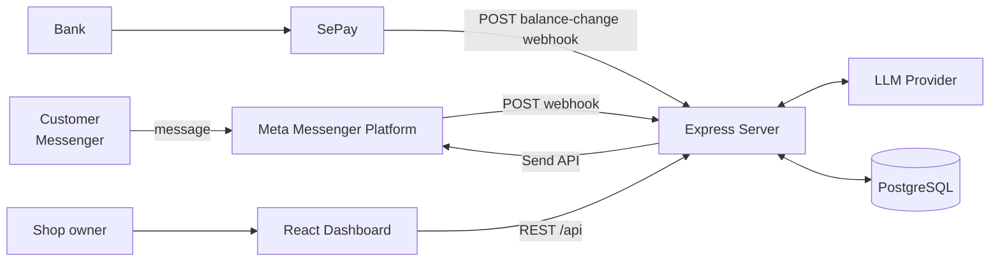
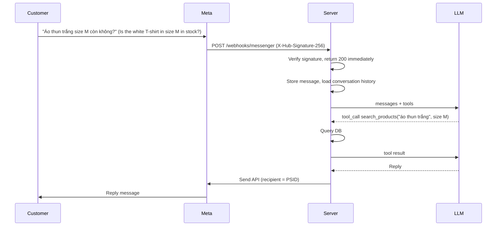
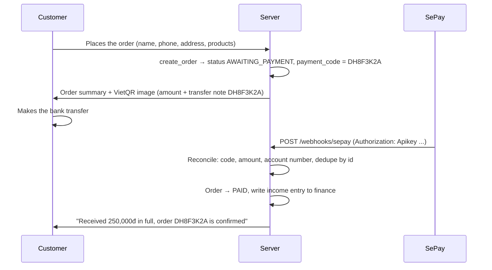
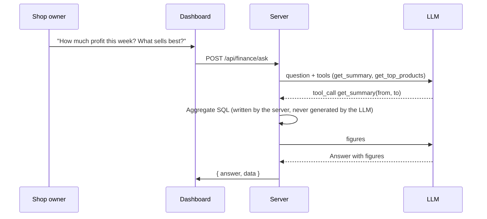

# Architecture

## Overview



## Backend layering

```
request → routes/ → middlewares/ → controllers/ → services/ → db/
                                        ↓ error (throw HttpError)
                                   errorHandler → { error: { code, message } }
```

| Layer | Does | Does not |
|---|---|---|
| `routes/` | Declares method + path, attaches middleware (signature/API key verification, body parser, `validate(schema)`), points to a controller | Write inline handlers, call services/db |
| `controllers/` | Reads `req.body` / `req.params` / `req.validatedQuery`, calls a service, picks the status code, returns JSON | Business logic, money calculations, opening transactions, accessing `db/` |
| `services/` | Business logic, transactions (order status change + ledger entry + stock decrement), external API calls, calls `db/` | Read `req` / write `res` |
| `db/` | Connection pool, migrations | |

Naming: `routes/orders/orders.js` → `controllers/orders/orders.controller.js` → `services/orders/order.service.js`.
Controllers are async functions; Express 5 forwards their errors to `errorHandler`, so no try/catch is needed.

Example:

```js
// routes/orders/orders.js
ordersRouter.post('/', validate(createOrderBody), ordersController.create)

// controllers/orders/orders.controller.js
export const create = async (req, res) => {
  res.status(201).json(await orderService.create(req.body))
}
```

### Feature folders

Every layer keeps its role, and inside each layer the files are grouped into **one folder per feature**, the same way `services/ai/` and `services/assistant/` already are. A feature uses the same folder name in every layer it appears in.

- Files keep their layer suffix (`.controller.js`, `.service.js`) so they stay easy to search for.
- Inside a folder, a prefix that only repeats the folder name is dropped: `routes/webhook.sepay.js` becomes `routes/webhook/sepay.js`, `db/assistant.steps.js` becomes `db/assistant/steps.js`.
- A new feature gets a new folder in each layer it needs; no new files directly under `routes/`, `controllers/`, `services/` or `db/`.
- Only shared entry points stay at a layer root: `routes/index.js` (mounts every router), and in `db/` the `pool.js`, `migrate.js`, `seed.js`, `migrations/` and the shared data-access layer `repos/`.
- `middlewares/`, `lib/` and `config/` are shared across features and stay flat.

| Feature | `routes/` | `controllers/` | `services/` | `db/` |
|---|---|---|---|---|
| `ai` | | | `client.js`, `toolLoop.js`, `prompts/`… (model layer) | |
| `alerts` | `alerts.js` | `alerts.controller.js` | `alerts.service.js` | `alerts.js` |
| `assistant` | `assistant.js` | `assistant.controller.js` | `assistant.service.js`, `agent.js`, `tools/`… | `assistant.js`, `files.js`, `steps.js`, `threads.js` |
| `auth` | `auth.js` | `auth.controller.js` | `auth.service.js` | `users.js` |
| `demo` | `demo.js` | `demo.controller.js` | `demo.service.js` | |
| `dev` | `dev.js` | `dev.controller.js` | | |
| `finance` | `finance.js` | `finance.controller.js` | `finance.service.js`, `ledger.service.js` | `finance.js`, `ledger.js`, `ledger.write.js` |
| `guardrail` (planned, NV-00) | | | `guardrail.service.js` | |
| `health` | `health.js` | `health.controller.js` | `health.service.js` | |
| `orders` | `orders.js` | `orders.controller.js` | `order.service.js` | `orders.js` |
| `payments` | | | `payment.service.js`, `fraud.service.js` | |
| `shop` | | | `shop.service.js` | `shop.js` |
| `webhook` | `messenger.js`, `sepay.js`, `sim.js` | `messenger.controller.js`, `sepay.controller.js`, `sim.controller.js` | `webhook.service.js`, `sim.service.js` | |

## Backend modules

| Module | Responsibility |
|---|---|
| `messenger.service` | Parses webhook events, sends messages (text, QR image, quick replies) via the Send API |
| `ai.service` | Calls the LLM, keeps conversation history, executes tools (`search_products`, `create_order`…) |
| `order.service` | Creates/updates orders, generates unique payment codes, manages the status lifecycle |
| `payment.service` | Receives SePay webhooks, reconciles transactions with orders, deduplicates, marks orders PAID |
| `finance.service` | Writes the income/expense ledger, aggregates reports, answers the shop owner's finance questions |

## Flow 1 — Customer messages → AI replies



Note: return `200` to Meta first and run the AI **asynchronously** (avoids timeouts/retries that cause duplicate replies). Deduplicate by `message.mid`.

## Flow 2 — Order creation + payment + anti-scam



If the customer sends a "transfer done" screenshot before any webhook arrives → the AI replies that the system is waiting for the bank's confirmation and does **not** confirm the order. Details: [PAYMENT_ANTI_SCAM.md](PAYMENT_ANTI_SCAM.md).

## Flow 3 — Finance assistant



## References

- Meta Messenger Webhooks: https://developers.facebook.com/docs/messenger-platform/webhooks
- SePay Webhooks: https://developer.sepay.vn/en/sepay-webhooks/tich-hop-webhook
