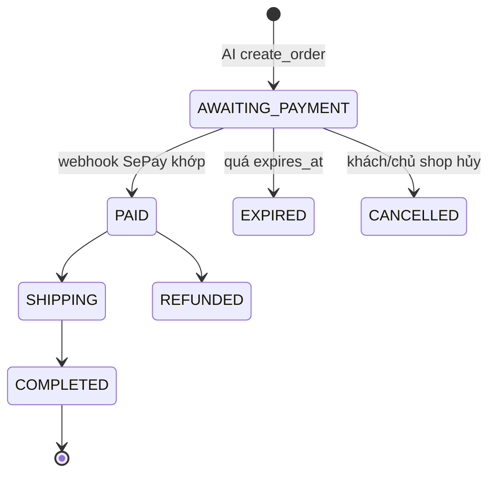

# Database (PostgreSQL)

Tiền lưu bằng `BIGINT` (đơn vị VND, không có phần thập phân).

## Bảng

### `shops`
| Cột | Kiểu | Ghi chú |
|---|---|---|
| id | uuid PK | |
| name | text | |
| fb_page_id | text UNIQUE | ID Facebook Page |
| fb_page_token | text | Page access token (mã hóa khi lưu) |
| bank_code | text | vd. `MB`, `VCB` (dùng tạo VietQR) |
| bank_account_number | text | Dùng để đối soát webhook SePay |
| bank_account_name | text | |
| created_at | timestamptz | |

### `products`
| Cột | Kiểu | Ghi chú |
|---|---|---|
| id | uuid PK | |
| shop_id | uuid FK | |
| sku | text | |
| name | text | |
| description | text | AI dùng để tư vấn |
| price | bigint | Giá bán |
| cost | bigint | Giá vốn → tính lợi nhuận |
| stock | int | |
| variants | jsonb | vd. `{ "size": ["S","M"], "color": ["trắng"] }` |
| image_url | text | |
| is_active | boolean | |

### `customers`
| Cột | Kiểu | Ghi chú |
|---|---|---|
| id | uuid PK | |
| shop_id | uuid FK | |
| psid | text | Page-scoped ID của khách trên Messenger |
| name, phone, address | text | |
| UNIQUE | (shop_id, psid) | |

### `conversations` / `messages`
| Cột (`messages`) | Kiểu | Ghi chú |
|---|---|---|
| id | uuid PK | |
| conversation_id | uuid FK | 1 conversation / customer |
| mid | text UNIQUE | Message ID từ Meta → chống xử lý trùng |
| role | text | `user` / `assistant` / `tool` |
| content | text | |
| created_at | timestamptz | |

`conversations` có thêm cờ `ai_paused boolean`: chủ shop bật lên khi muốn tự chat tay (handover).

### `orders`
| Cột | Kiểu | Ghi chú |
|---|---|---|
| id | uuid PK | |
| shop_id, customer_id | uuid FK | |
| payment_code | text UNIQUE | vd. `DH8F3K2A`, khách ghi vào nội dung CK |
| status | text | xem state machine bên dưới |
| subtotal, shipping_fee, total | bigint | |
| shipping_name, shipping_phone, shipping_address | text | snapshot lúc đặt |
| expires_at | timestamptz | hết hạn chờ thanh toán |
| paid_at | timestamptz | |
| created_at | timestamptz | |

### `order_items`
`id, order_id, product_id, name_snapshot, variant jsonb, unit_price bigint, unit_cost bigint, quantity int`

### `payment_transactions` (raw từ SePay)
| Cột | Kiểu | Ghi chú |
|---|---|---|
| id | uuid PK | |
| sepay_id | bigint UNIQUE | chống trùng khi SePay retry |
| gateway, account_number, code, content, reference_code | text | |
| transfer_type | text | `in` / `out` |
| transfer_amount | bigint | |
| transaction_date | timestamptz | |
| order_id | uuid FK NULL | gán khi đối soát khớp |
| match_status | text | `MATCHED` / `UNDERPAID` / `NO_ORDER` / `IGNORED` |
| raw | jsonb | payload gốc |

### `ledger_entries` (sổ thu chi)
| Cột | Kiểu | Ghi chú |
|---|---|---|
| id | uuid PK | |
| shop_id | uuid FK | |
| type | text | `INCOME` / `EXPENSE` |
| category | text | `SALES`, `SHIPPING`, `ADS`, `INVENTORY`, `OTHER` |
| amount | bigint | |
| order_id | uuid FK NULL | thu từ đơn hàng |
| note | text | |
| occurred_at | timestamptz | |

## State machine đơn hàng

- Trừ tồn kho khi chuyển sang `PAID` (hoặc giữ chỗ lúc tạo đơn và hoàn lại khi `EXPIRED`, tùy chọn).
- Ghi `ledger_entries` loại `INCOME/SALES` trong **cùng transaction DB** với việc đổi đơn sang `PAID`.

## Index nên có
- `orders(shop_id, status, created_at)`
- `ledger_entries(shop_id, occurred_at)`
- `messages(conversation_id, created_at)`
