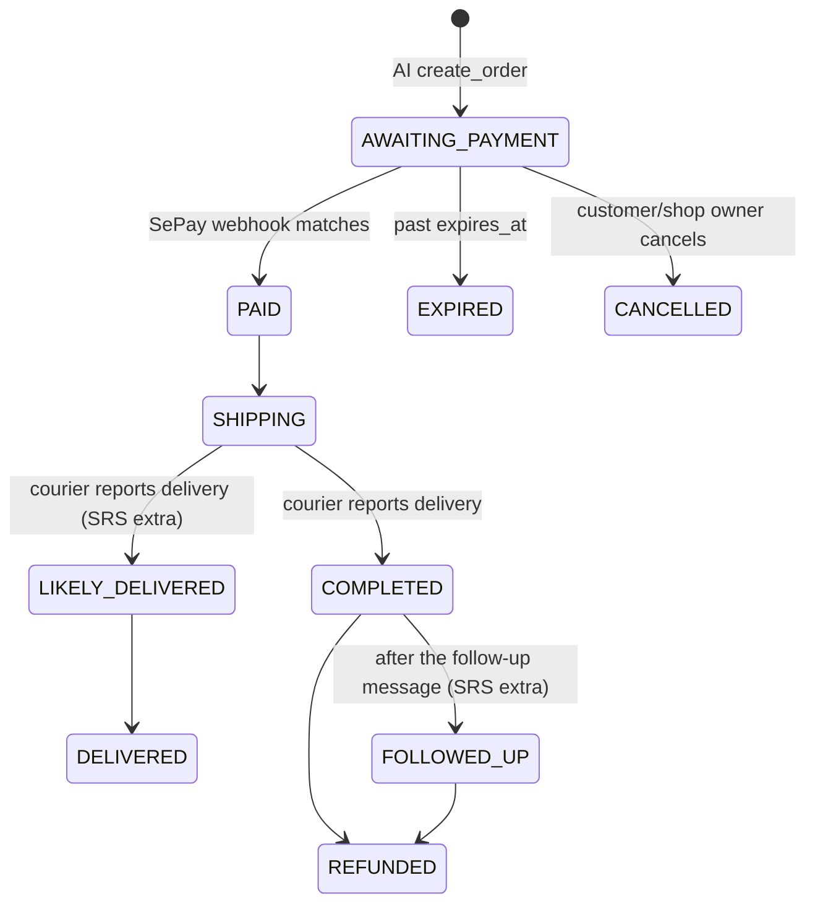

# Database (PostgreSQL)

Money is stored as `BIGINT` (VND, no decimal part).

## Tables

### `shops`
| Column | Type | Notes |
|---|---|---|
| id | uuid PK | |
| name | text | |
| fb_page_id | text UNIQUE | Facebook Page ID |
| fb_page_token | text | Page access token (encrypted at rest) |
| bank_code | text | e.g. `MB`, `VCB` (used to build VietQR) |
| bank_account_number | text | Used to reconcile SePay webhooks |
| bank_account_name | text | |
| created_at | timestamptz | |

### `products`
| Column | Type | Notes |
|---|---|---|
| id | uuid PK | |
| shop_id | uuid FK | |
| sku | text | |
| name | text | |
| description | text | Used by the AI for product advice |
| price | bigint | Selling price |
| cost | bigint | Cost price → profit calculation |
| stock | int | |
| variants | jsonb | e.g. `{ "size": ["S","M"], "color": ["white"] }` |
| image_url | text | |
| is_active | boolean | |

### `customers`
| Column | Type | Notes |
|---|---|---|
| id | uuid PK | |
| shop_id | uuid FK | |
| psid | text | The customer's Page-scoped ID on Messenger |
| name, phone, address | text | |
| UNIQUE | (shop_id, psid) | |

### `conversations` / `messages`
| Column (`messages`) | Type | Notes |
|---|---|---|
| id | uuid PK | |
| conversation_id | uuid FK | 1 conversation per customer |
| mid | text UNIQUE | Message ID from Meta → prevents duplicate processing |
| role | text | `user` / `assistant` / `tool` |
| content | text | |
| created_at | timestamptz | |

`conversations` also has an `ai_paused boolean` flag: the shop owner turns it on to chat manually (handover).

### `orders`
| Column | Type | Notes |
|---|---|---|
| id | uuid PK | |
| shop_id, customer_id | uuid FK | |
| payment_code | text UNIQUE | e.g. `DH8F3K2A`, written by the customer in the transfer note |
| status | text | see the state machine below |
| subtotal, shipping_fee, total | bigint | |
| shipping_name, shipping_phone, shipping_address | text | snapshot at order time |
| expires_at | timestamptz | payment deadline |
| paid_at | timestamptz | |
| risk_level | text | `LOW` / `MEDIUM` / `HIGH` — set by the hard-rule fraud check |
| created_at | timestamptz | |

### `order_items`
`id, order_id, product_id, name_snapshot, variant jsonb, unit_price bigint, unit_cost bigint, quantity int`

### `payment_transactions` (raw from SePay)
| Column | Type | Notes |
|---|---|---|
| id | uuid PK | |
| sepay_id | bigint UNIQUE | deduplicates SePay retries |
| shop_id | uuid FK NULL | resolved from the receiving account / order; deleted with the shop |
| gateway, account_number, code, content, reference_code | text | |
| transfer_type | text | `in` / `out` |
| transfer_amount | bigint | |
| transaction_date | timestamptz | |
| order_id | uuid FK NULL | set when reconciliation matches |
| match_status | text | `MATCHED` / `UNDERPAID` / `NO_ORDER` / `IGNORED` |
| raw | jsonb | original payload |

### `ledger_entries` (income/expense ledger)
| Column | Type | Notes |
|---|---|---|
| id | uuid PK | |
| shop_id | uuid FK | |
| type | text | `INCOME` / `EXPENSE` |
| category | text | `SALES`, `SHIPPING`, `ADS`, `INVENTORY`, `OTHER` |
| amount | bigint | |
| order_id | uuid FK NULL | income from an order |
| note | text | |
| occurred_at | timestamptz | |
| source | text | `manual` / `order` / `bank` / `agent` |
| label_id | uuid FK NULL | `labels` row (user-defined category) |
| counterparty | text | who paid / who was paid |
| raw_description | text | original bank description |
| dedupe_key | text | unique per shop when set → bank imports never duplicate |
| run_id | uuid FK NULL | agent run that wrote the row (for undo) |
| kind | text NULL | `BUSINESS_REVENUE`, `PERSONAL`, `EXPENSE`, `TRANSFER`; NULL means not yet classified. |
| channel | text NULL | `CASH`, `BANK`, `EWALLET`; NULL means unknown. |
| document_ref, industry | text NULL | Source document reference and business sector when known. |
| document_date | date NULL | Source document date when known. |
| manual | boolean NOT NULL DEFAULT true | Whether the entry is manually created; legacy entries of unknown origin are conservatively marked false. |

The migration leaves legacy `kind` and `channel` as NULL rather than guessing. Services must require a valid classification and channel for new manual entries, distinguish unknown from zero in reports, and never count an unclassified entry as business revenue. A legacy entry marked `manual = false` cannot be deleted through the manual-only flow unless its origin is established by a later, explicit process.

### `labels`
`id, shop_id, name, color, created_at`, UNIQUE `(shop_id, name)` — user-defined ledger labels.

### `agent_runs` / `agent_run_events`
One row per agent turn (`RUNNING`, `AWAITING_INPUT`, `AWAITING_APPROVAL`, `DONE`, `CANCELLED`,
`FAILED`, `UNDONE`) with `command`, `plan jsonb`, `result jsonb`, `error`. `agent_run_events`
stores the SSE steps: `(run_id, seq)` unique, `type`, `payload jsonb`.

### `changes` (undo log)
`id, shop_id, run_id, entity, entity_id, action (insert|update|delete), before jsonb, after jsonb, created_at`.
`undoRun` replays a run backwards within 24 hours; it refuses when a row was edited again later.

### `webhook_events` (intake + dedupe)
`provider` (`messenger` / `sepay` / `sim`), `external_id`, `type`, `shop_id`, `payload`,
`status` (`RECEIVED` / `PROCESSED` / `IGNORED` / `FAILED`), `error`, `received_at`, `processed_at`.
UNIQUE `(provider, external_id)` — the same provider retry is stored once and never handled twice.

### `fraud_checks`
`shop_id NULL, provider, external_id, level (LOW|MEDIUM|HIGH), rule, reason, metadata jsonb, created_at`.
One row per check, including signature failures (metadata only, no body).

### `blocklist`
`shop_id, kind (PSID|PHONE|BANK_ACCOUNT), value, reason`, UNIQUE `(shop_id, kind, value)`.

### `todos` / `pins`
`todos`: `title, detail, status (OPEN|DONE|DISMISSED), due_at, order_id`.
`pins`: saved references `(shop_id, kind, ref_id)`, UNIQUE together.

### `ai_usage`
`shop_id NULL, role, model, prompt_tokens, completion_tokens, created_at` — one row per provider call.

### Owner assistant

These tables are separate from Messenger `conversations` and `messages`. Every query must be scoped by the authenticated `shop_id`; foreign keys do not replace that authorization check.

| Table | Key columns | Purpose |
|---|---|---|
| `assistant_threads` | `(shop_id, id)`; `title`, `status`, `scope`, `created_at`, `updated_at` | Owner work threads; `status` is `alert`, `waiting`, `running` or `done`. |
| `assistant_messages` | `(shop_id, id)`; `conversation_id`, `role`, `body jsonb`, `seq`, timestamps | Owner and assistant messages; `conversation_id` is `hub` or a thread ID, not a Messenger ID. Updates retain the same message ID and sequence. |
| `assistant_steps` | `id`, `shop_id`, `conversation_id`, `message_id`, `state`, `view jsonb`, `actions jsonb`, `created_at`, `decided_at` | Proposed actions and their view; the message reference is scoped to the same shop. States: `working`, `waiting`, `done`, `undone`, `failed`. |
| `assistant_action_log` | `id`, `shop_id`, `step_id`, `user_id`, `tool`, `before`, `after`, `applied_at`, `undone_at` | Snapshots for applied actions and undo; the step reference is scoped to the same shop. |
| `assistant_files` | `id`, `shop_id`, `name`, `mime`, `size`, `content`, `created_at` | Uploaded content, limited to 2 MiB; the stored size must match the byte count. |
| `assistant_alerts` | `id`, `shop_id`, `level`, `title`, `reasons`, `order_id`, `detected_at`, `status` | Risk alerts: level `mid`/`high`; status `OPEN`/`HELD`/`DISMISSED`. Order ownership must be checked by the service. |

`assistant_action_log` and `assistant_alerts` serve only the owner assistant and are independent of `changes`, `agent_runs` and `fraud_checks`. The team will decide later whether to consolidate them.

`assistant_messages`, `assistant_steps` and `assistant_threads` use text conversation IDs so `hub` can exist without a thread row. Services validate thread and message ownership and consistency. Approval and action logging must share one transaction; state transitions and undo require concurrency checks as described in [ai-interface.md](ai-interface.md).

## Order state machine

- The constraint also accepts the SRS 2.1 aliases `SHIPPED` and `DELIVERED`; the dashboard,
  the assistant and the sample data use `SHIPPING` and `COMPLETED` so every status has a label.
- `EXPIRED` is set by a scheduled sweep when `expires_at` passes without payment.
- Decrement stock when moving to `PAID` (or, optionally, reserve it at order creation and release it on `EXPIRED`).
- Write the `INCOME/SALES` `ledger_entries` row in the **same DB transaction** that moves the order to `PAID`.

## Recommended indexes
- `orders(shop_id, status, created_at)`
- `ledger_entries(shop_id, occurred_at)`
- `messages(conversation_id, created_at)`
